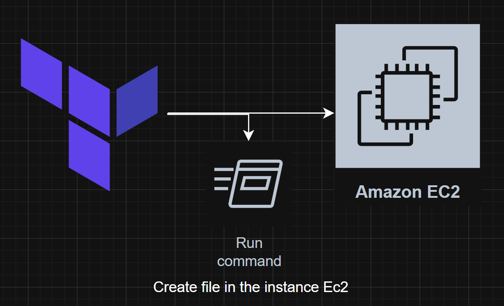

# Aws.Create.Ec2.Terraform

This Terraform configuration creates a simple AWS infrastructure: one EC2 instance and a security group that allows SSH access only from the CIDR blocks you choose. On first boot, a `user_data` script creates a test file (`new-test.txt`) in the user's home directory.

Each Terraform workspace (e.g. `qa`) gets its own resources, prefixed with `tf-<workspace>-`.

## Diagram



## Resources created

| Resource | Name |
| --- | --- |
| `aws_instance` | `tf-<workspace>-<instance_name>` |
| `aws_security_group` | `tf-<workspace>-<security_group_name>` (inbound SSH on port 22, all outbound traffic) |

## Requirements

- [Terraform](https://developer.hashicorp.com/terraform/install) >= 1.5
- An AWS account with credentials configured (`aws configure` or environment variables)
- An existing AWS key pair and its private key file (e.g. `test.pem`)
- An existing VPC with a public subnet (the default VPC works)

## Variables

Copy the template and fill in your values:

```bash
cp qa.template.tfvars qa.tfvars
```

| Variable | Description | Default | Example |
| --- | --- | --- | --- |
| `region` | AWS region | `us-east-1` | `us-east-1` |
| `ami_id` | AMI ID for the instance | - | `ami-0abcdef1234567890` |
| `instance_type` | EC2 instance type | `t2.micro` | `t3.micro` |
| `key_name` | Name of the AWS key pair | - | `test` |
| `vpc_id` | VPC ID for the security group | - | `vpc-0123456789abcdef0` |
| `instance_name` | Instance name (gets the workspace prefix) | - | `ec2` |
| `user_instance` | SSH user for the AMI | `ec2-user` | `ubuntu` |
| `access_key_path` | Local path to the private key | - | `./test.pem` |
| `security_group_name` | Security group name (gets the workspace prefix) | - | `ssh-sg` |
| `allowed_ssh_cidrs` | CIDRs allowed to SSH in | - | `["203.0.113.10/32"]` |

> `qa.tfvars` and `*.pem` are ignored by git so you don't commit sensitive data by mistake.

## Steps with Terraform

1. Init and create/select the workspace

    ```bash
    terraform init
    terraform workspace new qa
    terraform workspace select qa
    ```

2. Plan

    ```bash
    terraform plan -var-file qa.tfvars
    ```

3. Apply

    ```bash
    terraform apply -var-file qa.tfvars
    ```

4. Connect to the instance (the full command is shown in the `ssh_command` output)

    ```bash
    terraform output ssh_command
    ssh -i ./test.pem ec2-user@<public_ip>
    ```

5. Destroy the resources when you are done, so they stop costing money

    ```bash
    terraform destroy -var-file qa.tfvars
    ```

## Outputs

| Output | Description |
| --- | --- |
| `instance_id` | ID of the EC2 instance |
| `public_ip` | Public IP of the instance |
| `security_group_id` | ID of the security group |
| `ssh_command` | Ready-to-use SSH command |
